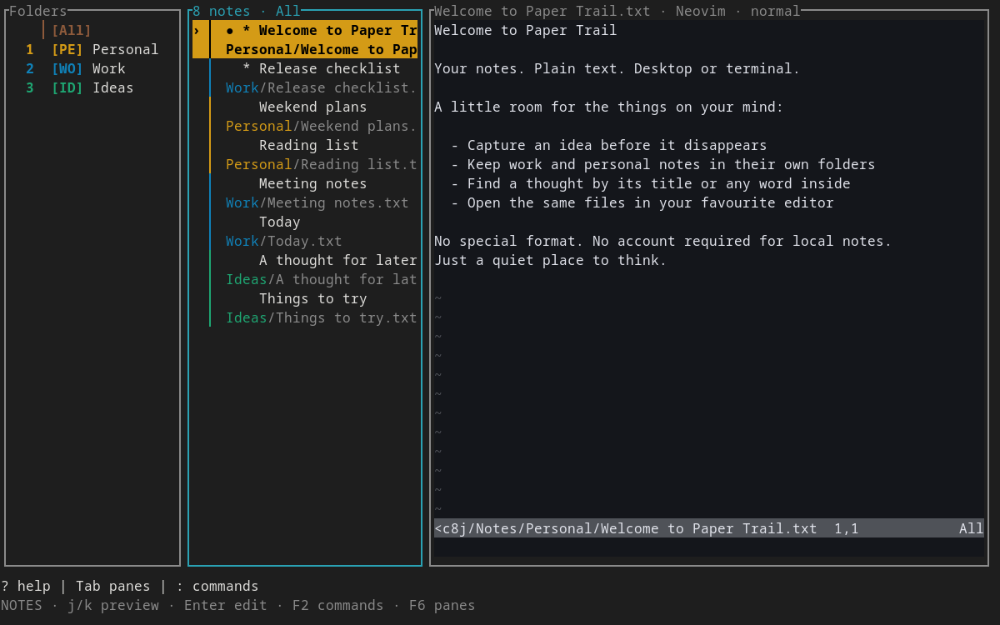

# Paper Trail TUI

`paper-trail-tui` is a Ratatui terminal frontend sharing Paper Trail's portable
core and filesystem storage. It needs no GTK, Python, Rust installation, network
service, or third-party runtime libraries on the destination machine.
The built-in editor is the default. Optional embedded Neovim requires an installed
`nvim` executable (0.9+); it is not bundled or needed for built-in editing.

## Run

Download the archive for your OS and CPU from GitHub Releases, or the
**Standalone TUI** workflow's artifacts for development builds. Check its SHA-256
checksum and extract it. Linux/macOS archives retain
the executable permission. Run in an interactive terminal:

```sh
./paper-trail-tui
./paper-trail-tui --notes-dir /path/to/existing/notes
./paper-trail-tui --config /path/to/paper-trail/settings.json
```

On Windows, use `paper-trail-tui.exe` in Windows Terminal or another terminal with
ANSI/VT support. Paths passed as CLI arguments need normal shell quoting when
they contain spaces. `--help` and `--version` work without an interactive terminal.

The first run creates only the default notes directory. Explicit folders must
already exist. Without `--config`, the TUI prefers existing native desktop
settings, then existing Linux Flatpak settings, then native defaults. Native
config locations follow the platform (XDG on Linux, Application Support on macOS,
and the roaming application-data directory on Windows). If both native and
Flatpak settings exist, use `--config` to select Flatpak explicitly.

## Embedded Neovim (optional)



To put **real Neovim inside the editor pane**, open the Paper Trail command prompt
with **F2**, type `set editor neovim`, and press Enter. Folder and note columns stay
visible. The choice is saved in the profile's `tui.json`; existing profiles continue
using the built-in editor until you opt in.

- In the Neovim pane, `:`, `/`, Tab, H/L, Ctrl combinations, counts, registers,
  macros, undo/redo, completion and syntax highlighting belong to Neovim—not the
  built-in Vim-style emulation.
- **F2** opens Paper Trail commands from any pane; **F6 / Shift-F6** changes panes.
  Type commands after the displayed `:` without adding another colon. For example,
  F2 → `sync-folders` → Enter opens sync selection; F2 → `q` saves and quits the app.
- Mouse input and bracketed paste are forwarded to Neovim inside its pane.
  `--no-mouse` is still respected. Resizing the terminal resizes the embedded UI.
- Normal Neovim configuration/plugins load by default. For predictable defaults,
  use F2 → `set nvim-config clean`; restore your configuration with
  `set nvim-config user`. Changing that option restarts the child after saving.
  Neovim settings such as line numbers, wrapping, and its colorscheme come from
  Neovim; Paper Trail's corresponding built-in-editor settings do not override them.
- F2 → `set editor builtin` saves and returns to the self-contained editor.
  Missing/unresponsive Neovim produces an actionable error, not a silent switch.
  At startup failure, text remains available in the built-in editor for that session;
  the saved preference is not overwritten.

### Saving and safety

The selected note is a Neovim **`acwrite` buffer**. Its `:write` / `:wq` goes through
Paper Trail's existing conditional filesystem adapter, so another editor's changes
cannot be overwritten merely by using `:w!`. Standard `BufWritePre`/`BufWritePost`
hooks run for Neovim's manual writes. Background autosave stays host-driven and does
not run Neovim's write hooks or interrupt Insert mode. Use F2 → `saveas PATH` for a
new recovery copy; writing the managed buffer to another filename through Neovim
is rejected. Local files, encrypted formats, account binding and vault keys do not
change. Sync protects the active managed buffer even while focus is in a sidebar.

Paper Trail mirrors real buffer changes independently. If the Neovim child exits
or crashes, latest **observed** text is retained, automatic saving pauses, and focus
returns to Notes. Enter restarts Neovim; F2 → `w` saves, `saveas PATH` preserves a
copy, or `reload!` explicitly discards pending edits. Neovim's `:q`/`:q!` closes the
editor child, not Paper Trail; it does not silently discard the host's retained text.
Use Paper Trail's F2 → `q!` when you explicitly want to discard and quit the app.

Only the selected note is managed by Paper Trail. Navigating/reloading creates a
fresh managed buffer (undo history is not retained across note switches). Help and
plugin buffers can be displayed, but other files opened directly inside Neovim are
not automatically adopted as Paper Trail notes. Use the sidebars for note selection.
Do not override the managed buffer's `buftype`/`BufWriteCmd` if you rely on the host's
save protections. GUI-specific UI extensions, terminal clipboard escape protocols,
and every possible plugin interaction are not emulated by the single-grid frontend.

Your Neovim configuration/plugins are **trusted local code**, with normal filesystem
and process access; they are not sandboxed. They can see plaintext notes just as an
external editor can. The private stdio bridge sends note text/UI input, **not OAuth
tokens, vault keys, or passphrases**. Managed buffers disable swap files and the child
uses `-i NONE` to avoid shared ShaDa history; Paper Trail handles note saving/recovery.
User plugins may still write their own caches or launch programs. Clean mode avoids
loading personal configuration/plugins.

## Keys and editing (built-in editor)

Three panes show folders, notes, and the editor. **H / L** switches panes left/right;
**Tab / Shift-Tab** also works. In insert mode, H and L remain typed characters.
Use **j/k** or arrows to browse: the highlighted note is immediately previewed
without moving keyboard focus. **Enter** focuses the editor; the note is already
loaded. Pending edits are saved before a different note is shown, and a failed
save leaves the original note, selection, and edits intact.

The folder column defaults to **16 terminal cells**, configurable with
`:set folder-width 10` through `:set folder-width 30`. Long names use an ellipsis;
`:path` opens a wrapping, scrollable full-path dialog. Below 80 columns the folder
pane hides automatically; pane navigation skips it. Folders remain accessible
through `:folder PATH` or `:folder NUMBER`.

The folder column has an **All** entry, GTK-style two-letter badges, and a colored
active-folder bar. All stays first and does not change folder numbers used by
`:folder NUMBER` or `:move NUMBER`. At narrow widths badges remain visible while
labels shorten; `:path` shows full folder information. No special icon font is needed.
Folder badges and note-row accents use GTK's exact shared RGB presets and custom
colors, including in All/search views. Focused rows use the folder color with
contrasting text. Exact color matching needs a true-color terminal; the overall
terminal background/theme is unchanged.

A **›** marks the highlighted list item, **●** marks the displayed note, **▎** marks
the active folder, and a cyan border identifies keyboard focus. A contextual footer shows
navigation/editing shortcuts and editor mode.

**Mouse support** is enabled by default: single-click notes to preview, click a
folder to open it while keeping focus in Folders, click panes to focus, and click editor text to position the
cursor. The wheel browses lists or scrolls the editor/help under the pointer.
Editor hit testing accounts for scroll position, line numbers, tabs, and wide
characters. Start with `--no-mouse` to retain native terminal mouse selection;
terminals that support it also permit Shift-drag to bypass application capture.
Mouse capture is released before external editing and when the TUI exits.

**?** shows scrollable help. List **/** searches filenames, titles, and full note bodies
across saved folders; **Esc** clears the filter. **p** toggles a selected note's pin.

The default built-in editor uses a practical Vim-style subset, **not full Vim compatibility**:

| Keys                            | Action                                       |
| ------------------------------- | -------------------------------------------- |
| `i`, `a`, `I`, `A`              | Insert / append at cursor or line boundary   |
| `o`, `O`                        | Insert a line below / above                  |
| `Esc`                           | Return to normal mode                        |
| `h j k l`, `w b`, `0 $`, `gg G` | Cursor movement                              |
| `v`, then movement              | Visual selection                             |
| `y`, `d` / `x` in visual mode   | Copy / cut selection                         |
| `x`, `dd`, `yy`, `p`            | Delete character/line, copy line text, paste |
| `u`, `Ctrl-R`                   | Undo / redo                                  |
| `/`, `n`, `N` in editor         | Literal find, next / previous match          |
| `Ctrl-N`, `Ctrl-S`, `Ctrl-Q`    | New note, save, save and quit                |

Counts, macros, registers, Vim plugins, and system-clipboard integration are not
implemented. Copy/paste uses an internal editor register; terminal bracketed
paste is supported in insert mode. Long lines scroll horizontally rather than
soft-wrap. Syntax highlighting and desktop-only features such as printing are
not part of this frontend.

## Commands

Press **:** in built-in normal mode, or **F2** from either editor, type a command,
then **Enter**. **Esc** cancels. `:` inside the Neovim pane belongs to Neovim.

**Tab / Shift-Tab** completes and cycles matching commands, `:set` options and
folder widths, preset colors, and saved folder numbers. `:folder` and `:move`
complete directory paths; `:saveas` completes files and directories. Paths with
spaces or Unicode and `~/` home paths are supported. A unique directory can be
completed further with another Tab. Suggestions appear above the prompt and
never execute a command; Enter is still required. Typing, pasting, or Backspace
starts a new completion cycle. Tab switches panes only when no prompt is open.

| Command                               | Action                                              |
| ------------------------------------- | --------------------------------------------------- |
| `:w`, `:q`, `:wq`                     | Save / save and quit; failed saves prevent quitting |
| `:q!`                                 | Explicitly discard pending edits and quit           |
| `:new [NAME]`, `:rename NAME`         | Create / rename a note                              |
| `:move PATH` or `:move NUMBER`        | Move into an existing folder                        |
| `:folder PATH` or `:folder NUMBER`    | Add / select an existing folder                     |
| `:all`, `:search TEXT`                | Show all notes / search across folders              |
| `:close-folder`                       | Remove active bookmark, never its files             |
| `:folder-up`, `:folder-down`          | Reorder the highlighted folder                      |
| `:pin`, `:color #rrggbb`              | Toggle current note pin / set active folder color   |
| `:color preset-0` through `preset-11` | Use a built-in folder color                         |
| `:delete`                             | Delete current note after typing `yes` and Enter    |
| `:replace 'OLD' 'NEW'`                | Undoable replacement of all literal matches         |
| `:edit`                               | Save and launch an external editor                  |
| `:refresh`, `:reload`                 | Rescan notes / reload a clean current note          |
| `:saveas PATH`                        | Save pending text into a new file, never overwrite  |
| `:reload!`                            | Explicitly discard edits and load the disk version  |
| `:set number`, `:set nonumber`        | TUI-only line-number preference                     |
| `:set folder-width N`                 | TUI-only folder width, 10–30 terminal cells         |
| `:set editor builtin/neovim`          | Choose the built-in or embedded Neovim editor       |
| `:set nvim-config clean/user`         | Choose Neovim defaults or personal config/plugins   |
| `:path`                               | Show the full highlighted folder/current note path  |

Paths after `:folder`, `:move`, `:rename`, and `:saveas` can contain spaces without
quotes. `:replace` arguments use shell-style quotes. Moves and renames resolve
filename collisions without overwriting another note. Deletion permanently
removes the file, rather than using a desktop trash service.

**External editing:** `$VISUAL` takes precedence over `$EDITOR`; default `vi` on
Unix or `notepad` on Windows. Editor arguments are parsed without running a shell;
the note path is passed as a separate argument. Use forward slashes in quoted
Windows editor paths, for example `"C:/Program Files/Editor/editor.exe" --wait`.
Configure graphical editors to wait for their document to close. The terminal
is restored before launching the editor and reinitialized afterwards. A successful
editor exit reloads the note; after a failed exit, use `:reload` explicitly.
External editing and the optional embedded Neovim backend need another program
installed; built-in editing remains self-contained.

## Shared data and safety

### Device-code sign-in (including SSH)

For a new client, run `:sync-configure https://YOUR_SYNC_SERVER`. Review the displayed
server and advertised identity-provider URLs, then type `yes` to trust the issuer.
PageUp/PageDown scroll long trust details; Esc rejects without saving. Discovery
runs without blocking editing; `:sync-discovery-cancel` discards its result.

Existing manual profiles remain manual. To use an older server or explicitly retain
manual authentication, use
`:sync-configure HTTPS_SERVER HTTPS_ISSUER PUBLIC_CLIENT_ID 'SCOPES'` (scopes optional).
Discovery failures never silently replace these values. An unchanged accepted issuer
needs no new confirmation; a change stops authentication/sync and requires reviewing
setup. Existing journal-bound identities require a separate profile and notes
directory, not an issuer/account migration. Non-interactive shared-client calls
reject unconfirmed changes. See [configuration ownership and precedence](encrypted-sync.md#configuration-ownership-and-precedence).

`:login` uses OAuth Device Authorization (RFC 8628), not a browser on the TUI host.
It shows an HTTPS verification URL and a short-lived user code. Open that URL on
another trusted device, enter the code, and approve the sign-in you started.
`:login-show` displays the full URL/code; Esc closes that view without cancelling.
Use `:login-cancel` or Ctrl-C to cancel. Editing and local autosave continue while
authorization is pending. Codes disappear on cancellation, completion, denial or
expiry; expiry never silently starts a new authorization request.

For example, allocate a terminal when connecting remotely:

```sh
ssh -t HOST '/path/to/paper-trail-tui --no-mouse'
```

Configure the public native client to allow the **Device Authorization** grant
(`urn:ietf:params:oauth:grant-type:device_code`), plus Refresh Token for
`offline_access`. Keep the same issuer, client ID and API-audience scopes. No client
secret, callback listener, forwarded port or browser installation is needed on the
SSH host. `:login-browser` remains available for explicit local browser/PKCE login;
GTK's Sign In continues using browser/PKCE. An issuer without a discovered device
authorization endpoint produces an actionable error, not a browser fallback.

SSH sessions (detected by `SSH_CONNECTION`/`SSH_TTY`) and Linux terminals without
`DISPLAY`/`WAYLAND_DISPLAY` keep tokens in memory only. They do not read, write or
delete desktop-keyring credentials, including on refresh/sign-out, so no hidden
keyring-unlock prompt is required. Other graphical sessions still use platform
secure storage when available, with memory-only fallback and no plaintext token file.

Device login authenticates the account only. Unlock separately with `:unlock` and
the masked vault passphrase; **never enter that passphrase on the provider's
verification page**. The SSH host must be trusted: it holds the plaintext working
files and the vault key in memory after unlock. Cancellation stops client polling,
not the provider's open approval page. An in-flight HTTPS call may take up to its
timeout to finish. If approval/identity validation has already committed, the UI
says cancellation is too late; use `:logout` to clear that session instead.

Optional encrypted synchronization is available through `:sync-configure`,
`:login`, `:unlock`, `:sync`, and `:sync-status`. Use `:create-vault` for the first
device and save its recovery key. `:lock` clears the memory-only vault key;
`:logout` also removes secure-stored credentials. Local files remain plaintext.
See [encrypted sync](encrypted-sync.md) for setup, threat boundaries, and limitations.

Use **`:sync-folders`** to select collections interactively: arrows/`j`/`k` move,
Space or a mouse click toggles a checkbox, Enter saves all selections, and Esc
(or Ctrl-C) cancels without writing configuration. PageUp/PageDown scroll the
list; `i` opens full, scrollable name/path/ID details and Esc returns to the list.
Both bookmarked local folders and known remote folders appear. Unselecting keeps
local and remote notes; selecting a remote-only folder uses its existing mapping
or the configured download root. Unchecking every folder is supported without
resetting the vault, journal, or mappings. Automatic sync pauses while this dialog
is open; saving a stale configuration is rejected instead of overwriting changes
from another frontend. Editor contents are never replaced by selection changes.

`:sync-add-folder PATH`, `:sync-remove-folder PATH`, `:sync-select-folder ID`, and
`:sync-unselect-folder ID` remain compatibility shortcuts, not required for normal
selection. `:sync-map-folder ID '/absolute/path'` explicitly chooses a device's
directory; `:sync-download-dir PATH` sets where newly discovered collections are
created. Empty folders sync too. Legacy assignments that cannot be proven stop
safely: confirm them with `:sync-map-legacy NOTE_ID FOLDER_ID` (or GTK Configure
Sync). `:sync-accept-remote FOLDER_ID` acknowledges conflicting remote name/color
metadata while keeping the local directory. Directory scans remain non-recursive.

Notes, bookmarks, pins, folder colors, and language overrides share the desktop
format. TUI preferences live in `tui.json` alongside the selected settings file;
desktop window/layout preferences are not changed by TUI commands. Settings
updates preserve unknown fields, merge unrelated concurrent changes, and reject
conflicting changes. After a settings conflict, restart to reload preferences;
save any pending text first.

Both frontends check note contents before autosaving. If another client changed
the file, the save is blocked, pending text remains in memory, and TUI autosave
pauses. Use `:saveas PATH` for a separate copy or `:reload!` to discard your edits
explicitly. Cooperating Paper Trail writers use advisory lockfiles beneath
`.papertrail-locks/`; those directories are not notes. Unrelated editors do not
honor these locks: content checks detect existing changes, but cannot prevent an
external write racing the final filesystem operation. Avoid editing the same
note simultaneously in unrelated programs.

Autosave runs after 350 ms of inactivity. Quit normally before closing a terminal.
On a terminal error or Unix termination signal, terminal state is restored and
pending text is saved if possible. If a save fails, the TUI attempts a separate
recovery file under the platform's local data directory, `paper-trail/recovery/`,
and prints its path. Forced termination (`SIGKILL`, a power failure, or killing a
Windows process) cannot guarantee recovery of edits not yet autosaved.

## Build and distribution

```sh
cargo run --locked --bin paper-trail-tui
cargo test --locked -p papertrail-core -p papertrail-storage -p papertrail-tui
cargo build --release --locked --bin paper-trail-tui
```

Building the TUI requires Rust 1.88 or newer. Its dependency graph excludes
GTK/GLib. The six-target CI matrix builds,
tests, verifies linkage, and packages:

| OS      | Architectures | Linking                                                                     |
| ------- | ------------- | --------------------------------------------------------------------------- |
| Linux   | x86_64, ARM64 | Fully static musl; no ELF interpreter or shared-library dependencies        |
| Windows | x86_64, ARM64 | Static Rust dependencies and C runtime; built-in Windows system DLLs remain |
| macOS   | x86_64, ARM64 | Static Rust dependencies; Apple system libraries remain dynamically linked  |

macOS does not support fully static executables. Artifacts are not signed or
notarized; OS download-security prompts can apply. Build on an older supported
macOS SDK/deployment target if compatibility with older macOS versions is needed.

For a static Linux build, install the musl compiler and Rust target, then run:

```sh
rustup target add x86_64-unknown-linux-musl
cargo build --release --locked --target x86_64-unknown-linux-musl --bin paper-trail-tui
python3 build-aux/package_tui.py x86_64-unknown-linux-musl
```

Windows MSVC builds use `RUSTFLAGS="-C target-feature=+crt-static"` with an explicit
`--target`. `build-aux/package_tui.py` rejects dynamically linked Linux builds,
Windows artifacts importing the dynamic MSVC/UCRT runtime, and non-system macOS
dependencies. Python is build tooling only; it is not included in the executable.
